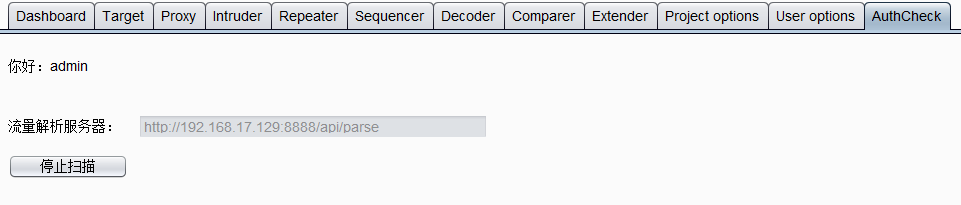
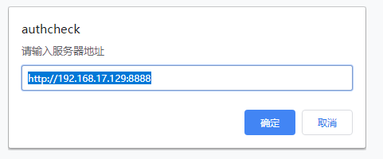
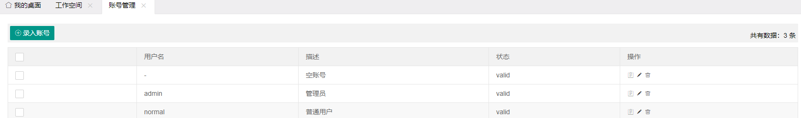
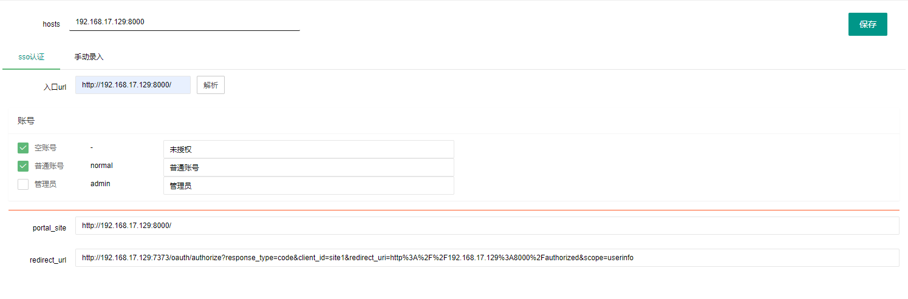
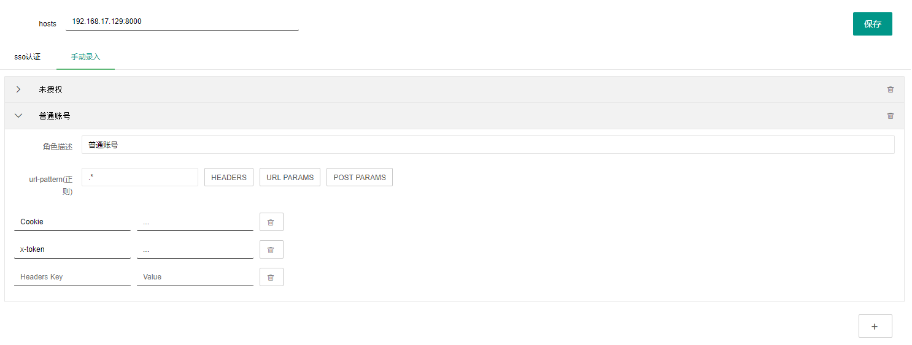
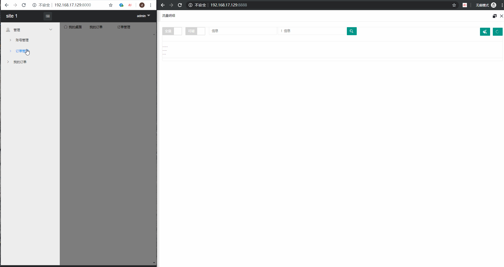

# Broken Access Control Detection Tool

**Language**: [中文](README.md) | English

[Project introduction](https://mp.weixin.qq.com/s/vwF7aTvk-U-SnJqO3f80gA)

# Quick Start

## Deployment

### Broken Access Control Detection Tool

- Start the service

```bash
cd authcheck
docker-compose up -d
```

- Start the demo site

```bash
cd examples
# Replace your-ip in docker-compose.yml with the IP address of the current machine so it can be accessed.
docker-compose up -d
```

### Traffic Capture

Traffic can be sent to the broken access control detection server through a Burp plugin, browser extension, proxy server, and other methods.

The `traffic` directory contains two examples: a Burp plugin and a Chrome extension.

1. Burp plugin

    After loading it, enter the address of the broken access control detection server. Open any page in the browser, log in, and click Start Scan.

    

2. Chrome extension

    After loading it, enter the address of the broken access control detection server. Open any page and log in.

    

## Usage

### Login

The tool currently has two built-in accounts, as follows. The default port is `8888`.

- Administrator

    admin: admin123
- Regular user

    normal: normal123

For production use, you can integrate your company's internal authentication system to identify users.

The `examples` directory includes two demo sites, using default ports `8000` and `8001`, and an SSO authentication site, using default port `7373`.

- Administrator

    admin: admin123

- Regular user

    normal: normal123

During use, if logging in to a site under `examples` causes the broken access control detection tool's login state to expire, consider opening the target site in a private browsing window.

### Pre-configuration

The tool supports detection for two types of systems: SSO authentication and manually entered authentication information. SSO authentication is demonstrated with the sites under `examples`. To adapt it to your company's internal SSO, modify the related authentication logic.

- Enter accounts

    First, enter some account information so the tool can automatically log in to SSO. This demo simply records usernames and passwords. To enter an empty account, set the username to `-`.

    

- Workspace

    Before testing, create a workspace for the target site. After creating it, select different authentication logic based on the system being tested. For systems integrated with unified authentication, you only need to enter the homepage URL, click the parse button, and select the account to use.

    

    The automatic authentication logic still needs to be implemented by you. The sites under `examples` are only used here as a demonstration.

    For systems where automatic authentication is inconvenient to implement, you can choose to manually enter authentication information.

    

### Broken Access Control Vulnerability Detection

The workflow is as follows: the Burp plugin or Chrome extension sends traffic to the broken access control detection server in real time, and testers can monitor it in the traffic details page.

Scanned requests are deduplicated when they are exactly the same. After you click the Clear button in the upper-right corner, traffic in the workspace is cleared, and the deduplication rules are also cleared. To view traffic that has already been cleared, select the All button in the upper-left corner.

Requests that may be problematic during testing are highlighted. Select the Suspicious button in the upper-left corner to view only potentially problematic requests.

The form at the top supports filtering. The filter rules are contains and does not contain. If there are multiple terms, separate them with `|`.

Each request packet has two buttons: Block and Replay. Click Block to add the corresponding block rule to the form above. When querying again or listening for traffic, traffic that matches the block rule will no longer be displayed. It is only hidden; the actual traffic still exists. Click Replay to replay that request, which is useful during retesting.

Each time the traffic details window is opened, the session information for the corresponding workspace is refreshed. Workspaces that use manually entered authentication information are not refreshed.

### Operation Demo



# Development Guide

If the system is not integrated with unified authentication or automatic authentication cannot be implemented at scale, you can deploy the tool and manually enter authentication information for each workspace.

If automatic authentication can be implemented for the target system, you can customize the tool by referring to the content below.

## Code Structure

```bash
authcheck/
├── app
│   ├── common
│   │   ├── decorators.py             # Decorators
│   │   ├── func.py                   # Functions used in templates
│   │   ├── __init__.py
│   │   └── util.py                   # Helper utilities
│   ├── conf
│   │   ├── conf.py                   # General configuration
│   │   ├── __init__.py
│   │   └── secret.py                 # Secret, database, and other configuration
│   ├── core
│   │   ├── flow.py                   # Site parsing
│   │   ├── identify                  # Workspace authentication flows for different system types
│   │   │   ├── direct.py                 # Directly entered authentication information
│   │   │   ├── __init__.py
│   │   │   └── sso.py                    # Systems integrated with unified authentication (example)
│   │   ├── __init__.py
│   │   ├── jobs.py                   # Scheduled tasks
│   │   └── lib.py                    # Other functions
│   ├── __init__.py
│   ├── model
│   │   ├── exception.py              # Exception class definitions
│   │   ├── __init__.py
│   │   ├── model.py                  # Simple models
│   │   └── po.py                     # Database models
│   ├── static
│   ├── templates
│   └── web
│       ├── api.py                    # Open APIs
│       ├── error.py                  # Exception handling
│       ├── __init__.py
│       ├── web.py                    # Web pages
│       └── ws.py                     # Traffic listener
├── docker-compose.yml
├── Dockerfile
├── favicon.ico
├── README.md
├── requirements.txt
├── uwsgi.ini
└── wsgi.py
```

## Main Customization Process

- Determine what information is required for the automatic authentication process, and add the corresponding model in `app/model/po.py`.
- Modify pages under `app/templates/`.
- Add your own authentication flow and configuration under `app/core/identify`.

The tool currently includes a simple automatic SSO authentication example, which you can use as a reference when customizing it.
